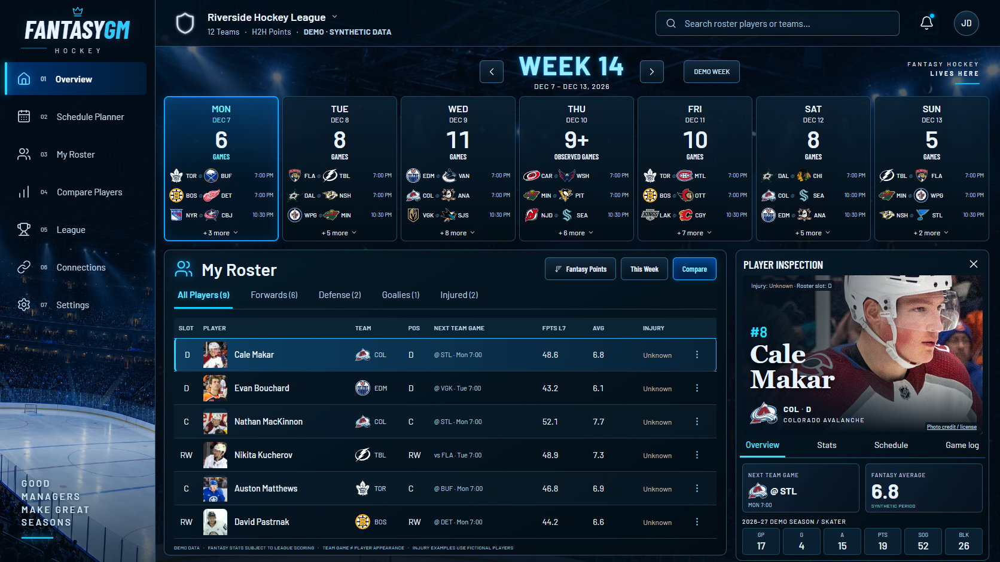

# Dark Arena Overview milestone

Scope: frontend foundation and Overview only. The other approved screens remain future work. Existing Python services, Yahoo authentication/privacy restrictions, PuckAPI behavior and MCP policy are unchanged.

The approved Overview screenshot was reviewed at 1672×941. The implementation reproduces its shell, seven day cards, roster table, selection treatment, portrait inspection panel and blue arena palette using semantic reusable React components. The installed Taste skill's general consistency and visual-review principles support this work; the approved app design takes priority over that skill's marketing-page style rules.

## Acceptance and visual comparison

- The calendar begins at y=161 and the roster/inspection panels at y=418 at reference width, matching the approved composition.
- The first visual pass found a partial-coverage card shifting the lower grid and compressed roster rows. The warning was contained and six rows expanded to reference-like spacing.
- The inspection highlights were shortened so the portrait, tabs and statistic strip fit the reference hierarchy.
- Phone checking caught visually hidden table labels escaping their scroll container. A positioned scroll container fixes that cause; the browser test rejects document overflow at all four viewport widths.
- Keyboard tests cover tabs and mobile menu focus/Escape; reduced motion is respected. Automated axe scans of desktop/phone initial states report no WCAG A/AA violations.
- The fixture UI makes zero external requests and produces no browser errors in the repeatable checks. Fonts, portraits and arena are local.

Current deliberate differences are documented in the frontend README: historical licensed photography, official team logos and the original decorative arena, synthetic dates/source notices, corrected tab counts and honest partial/unknown/unavailable behavior. No exact-font or pixel-exact imagery claim is made.

[Laptop](frontend/overview-laptop.png) · [Tablet](frontend/overview-tablet.png) · [Phone](frontend/overview-mobile.png)

## Injury and official-asset update

The Injured tab follows Goalies and counts only supplied DTD/Out/IR/IR+ injury designations, independently of assigned roster slots and search. Injured players remain in positional filters. Three clearly fictional rows demonstrate injured and healthy examples; all six real NHL players have unknown current injury data. The default nine-row roster scrolls within the original six-row footprint.

Authentic player photographs replace all AI portraits through one ID-checked component. Official NHL dark-background team logos replace generic marks, using a centralized 32-team map and consistent sizing/fallbacks. Historical photos are linked through Wikidata NHL IDs and checked against NHL records and birth dates. Image credits and distributed notices identify all photographers/licenses. Logo redistribution/commercial permission remains unconfirmed; see [asset provenance and rights limitation](../frontend/ASSETS.md).

The updated screenshot comparison preserves the reference's sidebar/header, calendar and panel positions and large portrait treatment. The photo/pose/uniform differ because these are authentic licensed historical photographs. The initial comparison caught clipped facial framing and undersized padded logo artwork; focal framing and display sizing were corrected. Compact schedule text still differs from the reference. The Injured tab, injury/slot labels, credits and fictional examples are intentional additions.

[Injured desktop](frontend/overview-injured-desktop.png) · [Injured phone](frontend/overview-injured-mobile.png)

## Validation

From `frontend/`: `npm test`, `npm run typecheck`, `npm run format:check`, `npm run build`, `npm run test:browser`.

The repeatable browser command checks layout overflow and captures at 1672, 1440, 768 and 390px. Injury-filter counts, keyboard activation and positional membership are checked at all four widths. Other fixture interactions run at desktop, followed by phone navigation checks; this is not exhaustive interaction coverage at every width. It rejects external requests and console errors and runs axe A/AA scans on initial desktop/phone states. Captures are generated from the production build; the checked-in images are synthetic review evidence. All 783 existing offline Python tests passed again after frontend implementation, together with Ruff, Python formatting and strict mypy. No Python dependency or implementation is changed by this milestone.

## Independent review and corrections

The independent whole-branch review found two substantive issues, both addressed in one correction pass:

- A synthetic fixture lived under a directory excluded by the existing provider-data privacy rule. A tracked-tree export reproduced the broken build. The fixture now lives under `src/fixtures/`; the root ignore rule remains intact. Delivery checks include a fresh Git export, offline dependency installation, tests, production build and browser checks.
- Calendar buttons omitted counts from accessible names and described unknown coverage as partial. Four regression tests first failed, then passed after each certainty state received its own announcement and the actual reason was connected as an accessible description.

There are 29 unit/component and asset-registry tests. The independent reviewer examined the reference and all four captures. One minor visual difference remains for user review: compact schedule matchup/time typography is smaller than the reference. Automated accessibility results cover the scanned states, not assistive-technology certification or all interactions.

Fresh-export checks also caught Windows Git converting frontend text files to CRLF, which made the formatter fail despite a successful build. Frontend-scoped Git attributes now keep text as LF without changing Python or root repository rules; the export formatting check was rerun after this correction.

Implementation decisions: use the clean existing checkout on a dedicated feature branch rather than creating another worktree; adapt the approved product plan into three implementation tasks recorded in a manual ledger. These choices trade directory isolation and scripted bookkeeping for simpler delivery. No additional screens are implemented.

The main JavaScript bundle is approximately 81KB gzip, with about 1.9MB of licensed historical photographs plus the decorative arena and official SVG logos and locally bundled Latin fonts. There is no routing library, global-state framework, UI framework, backend service, database or subscription dependency in this slice.

Run instructions and model semantics are in [frontend/README.md](../frontend/README.md). The PR must remain unmerged pending the user's approval; do not proceed to My Roster, Player Profile or other screens during this review gate.
